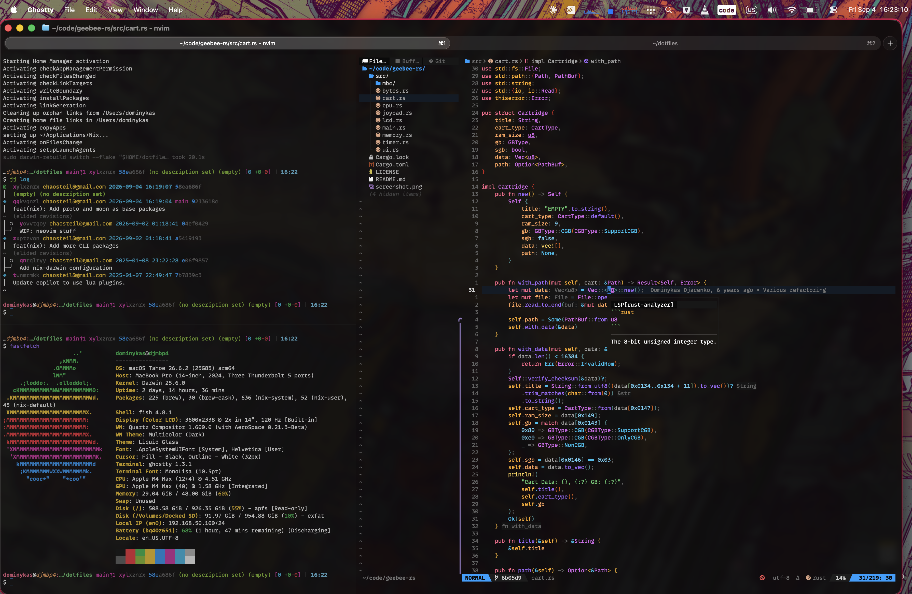
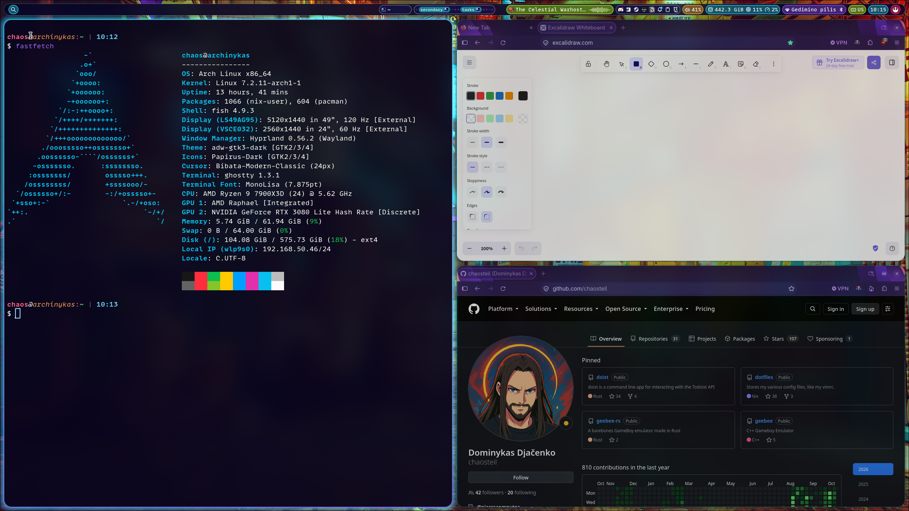

# Chaosteil's Dotfiles

## Description

The configuration files of my machines, with the setup for a new one.

[nix](https://nixos.org/download/) applies everything. The header of
`nix/flake.nix` has the steps. The same flake serves macOS (nix-darwin
with home-manager) and Linux (home-manager for the user, and
[system-manager](https://github.com/numtide/system-manager) for the
system layer in `nix/system/`: GPU drivers, units and the firewall).

To set up a new Arch machine, see [`setup/arch-nix/`](setup/arch-nix/README.md).

## Layout

- `nix/`: the flake. `nix/hosts/` has one file for each machine.
  `nix/home/` has the home-manager modules, `nix/darwin/` the nix-darwin
  modules and `nix/system/` the system-manager modules.
- `agents/`: the instructions, hooks and skills for the coding agents.
  home-manager links them into `~/.agents`, `~/.claude`, `~/.codex` and
  `~/.gemini`.
- `setup/arch-nix/`: the Arch packages that the nix layers need, and the
  install script.
- The other directories hold the configuration of one program each, for
  example `fish/` and `nvim/`. Each one mirrors the home directory.
  home-manager links the files from `nix/home/`.

## Screenshot

